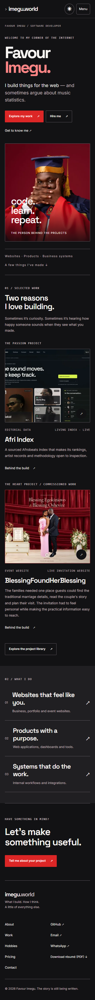
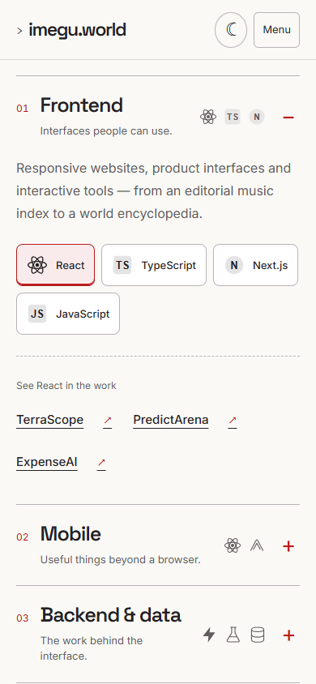
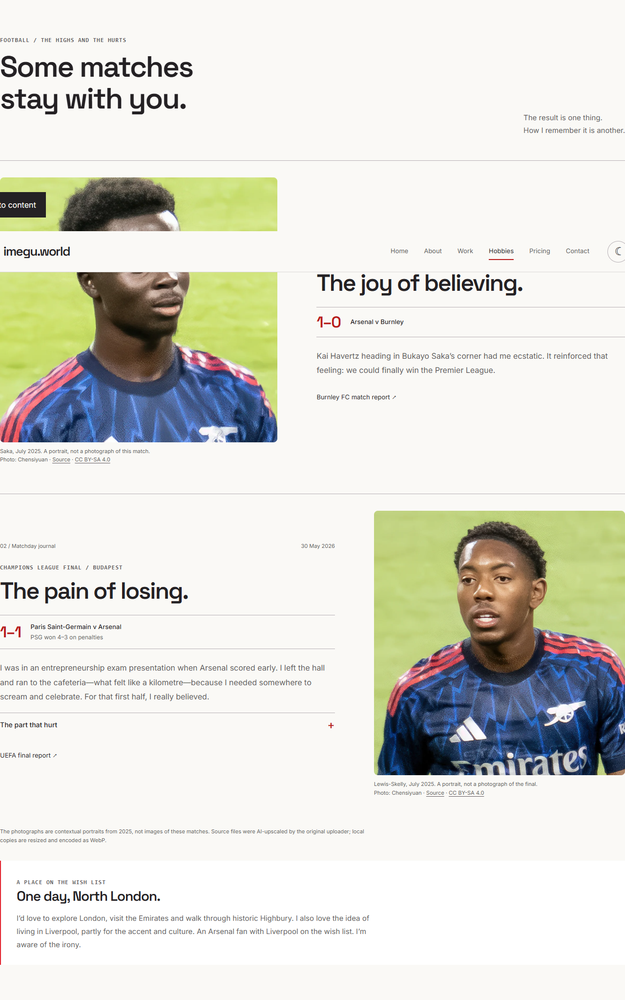
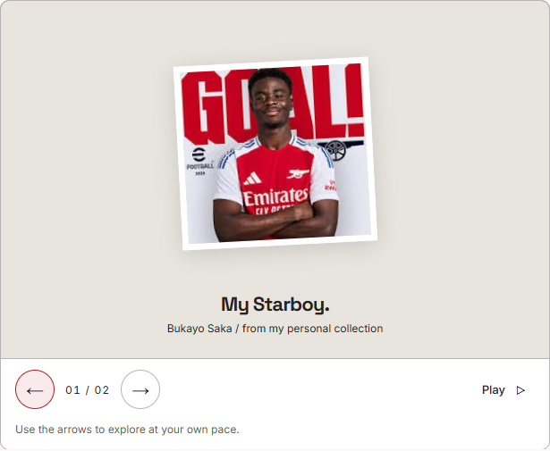

# Overhaul verification — 15 November 2026

Production build and TypeScript pass. Ten Node tests cover prerendered HTML/metadata, preserved content, assets, and contact validation/provider/rate-limit behavior. Browser verification covers 56 route/viewport combinations (eight routes at 320, 360, 390, 430, 768, 1024 and 1440px), with no horizontal overflow or hydration errors. Eight representative routes remain readable without JavaScript. Tested client navigation/back-forward, theme persistence/toolbar metadata, mobile dismissal/focus, capabilities, character expansion and mocked contact failure/success. No real email was sent.

Normal-motion checks cover intro completion, five-second gallery advance, pause/manual controls, reduced-motion behavior and Starboy dialog Escape dismissal. Screenshots below were captured from the running production build, in dark and light themes.

## Lighthouse lab evidence

| Metric | Existing production | New local production build |
| --- | --- | --- |
| Performance | 59 | 97 |
| Accessibility | 100 | 100 |
| SEO | 100 | 100 |
| LCP | 4.1 s | 2.6 s |
| CLS | 0.444 | 0.001 |
| TBT | 30 ms | 10 ms |

These are single mobile Lighthouse lab runs, not field or 75th-percentile measurements. The baseline was https://imegu.world; the new build was served locally, so network conditions differ. TBT is not INP. The final deployed preview is checked separately. Initial main JavaScript is 104.49KB gzip; route chunks load separately and the home intro no longer imports the motion library.

## Remaining setup and assets

- Configure `RESEND_API_KEY`, `CONTACT_FROM_EMAIL`, `CONTACT_TO_EMAIL` and verify the sender domain before testing real delivery. Missing configuration deliberately returns 503. See [contact setup](contact-setup.md). The warm-instance rate limiter is best effort, not shared across instances.
- Authorized artwork is still needed for Satoru Gojo, Yuno, Yuta Okkotsu, Katsuki Bakugo and Endeavor. The attachment contains screenshots, not those source artworks; the site uses honest expandable entries without fake portraits.
- The supplied Saka photograph is only 204×192, so it is displayed as a small print. A higher-resolution original would improve it.
- Wikimedia portraits are contextual July 2025 images, explicitly not photos of the 2026 matches. Attribution/license/source and upstream AI upscaling are recorded in [asset credits](assets.md).
- Production merge remains for review.

## Screenshots

